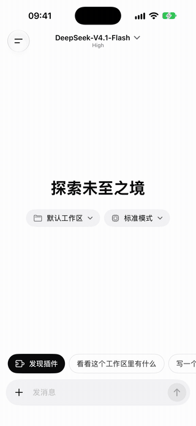
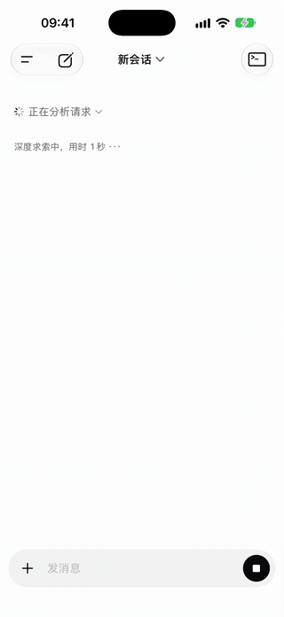
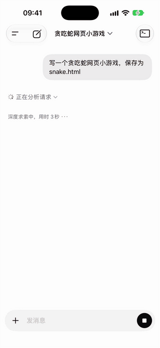
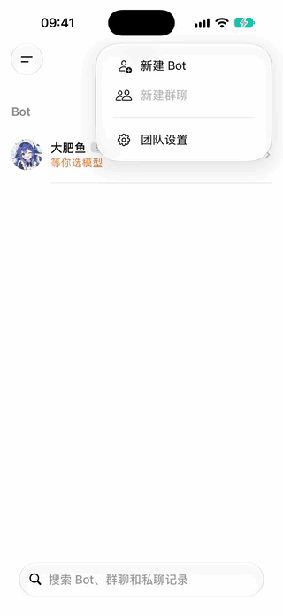
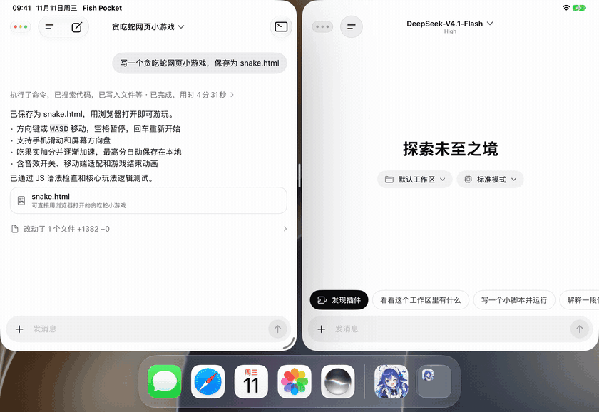
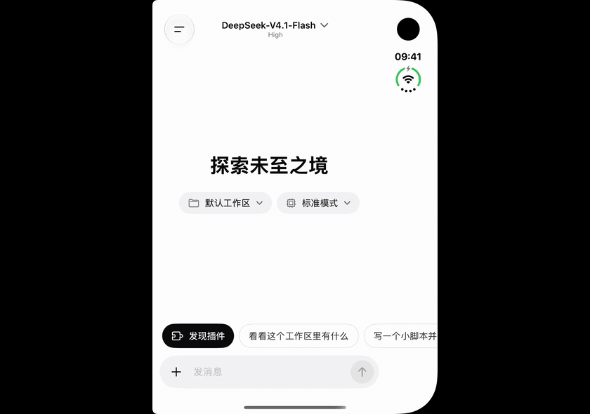

<p align="center">
  
</p>

<h3 align="center">Fish Pocket</h3>

<h1 align="center">DSH (DeepSeek Harness) running on your iPhone and iPad, with a fully native interface</h1>

<p align="center">
  <b>No computer. No server. Not a web wrapper. The engine runs inside the app, and every screen is rebuilt in SwiftUI for a native experience on both iPhone and iPad.</b>
</p>

<p align="center">
  <b>It matches the official DSH Web UI feature for feature, and the agent can also use what your iPhone already has: Calendar, Reminders, Health, Photos and Maps.</b>
</p>

<p align="center">Want an agent in your pocket too? <a href="https://testflight.apple.com/join/2SCftb2M"><b>Join the TestFlight beta</b></a> (recommended, available worldwide) or <a href="https://apps.apple.com/app/id6830703602">get it on the App Store</a> (outside mainland China), and a ⭐ helps.</p>

<p align="center"><a href="https://fish.deepseek1024.com/en/">Website</a> · <a href="README.md">中文</a></p>

## See it work

<table>
<tr>
<td align="center" width="33%"><br/><b>Plugin market</b><br/><sub>Install a safety-net plugin on the phone, and a destructive command gets blocked</sub></td>
<td align="center" width="33%"><br/><b>Device capabilities</b><br/><sub>Say it once: the meeting is in Calendar and the reminder is set</sub></td>
<td align="center" width="33%"><br/><b>Widgets and Dynamic Island</b><br/><sub>Tasks keep running in the background, with progress on the Home Screen</sub></td>
</tr>
</table>

<p align="center">
  
  <br/>
  <b>Bot mode</b>
  <br/>
  <sub>Make a Bot, hand it a task, and it searches the web and reports back; connect the services you use once</sub>
</p>

<p align="center">
  
  <br/>
  <b>Multiple windows on iPad</b>
  <br/>
  <sub>Two windows side by side, each with its own session: one edits a game, the other commits code</sub>
</p>

<p align="center">
  
  <br/>
  <b>iPhone Duo</b>
  <br/>
  <sub>Start a task on the cover screen, unfold, and the same session keeps running with the sidebar beside the chat</sub>
</p>

<p align="center"><sub>These are recordings of the app running, with waits cut or sped up. They show the Chinese interface; the app also comes in English and Spanish.</sub></p>

## What it does

- **Uses what your iPhone already has.** The agent checks your calendar, adds reminders, reads health data, looks up contacts and searches maps, each one turned on by you. See [Device capabilities](#device-capabilities).
- **Everything the official Web UI does.** Chat, tool calls, file editing, search, plan mode, approvals, subagents, scheduled tasks and plugins: what the official DSH Web UI can do, this can do.
- **A fully native interface.** Chat, approvals, the workbench, plugins and settings are all rebuilt in SwiftUI and designed for iOS, not a web page in a WebView. Dark mode is supported: follow the system, or pick light or dark in Settings. The official Web UI is still there in Settings if you want it.
- **A terminal that works.** Built-in bash, `node`, `pnpm`, `python3`, `pip` and `git`, plus `rg`, `jq`, `curl`, `sed`, `awk` and other everyday commands.
- **Built-in Python.** Python 3.15 is embedded in the app with the full standard library. `pip install` works for pure-Python packages, and so does `venv`. Packages with compiled extensions (numpy, pandas and the like) do not install yet.
- **Built-in Git.** Statically linked libgit2, no child processes. `clone`, `commit`, `branch`, `merge`, `stash`, `pull`, `push` and the rest of everyday git work, with output that matches real git so the agent reads it as usual. Private repositories authenticate over HTTPS with a token.
- **A built-in DSH plugin store.** A DSH ecosystem plugin market comes preset: browse and search on the phone, install with one tap, and the plugin is ready to use, no computer involved. Add store sources you trust under Index Sources, or install pure JavaScript plugins straight from npm.
- **A workbench.** Terminal, file preview, built-in browser and change review in one panel.
- **Made for iOS.** Dynamic Island and Lock Screen Live Activities, Home Screen and Lock Screen widgets, a Control Center button, Siri and Shortcuts, and tasks that continue in the background.
- **Made for iPad too.** A persistent sidebar, a side workbench, multiple windows, file drag and drop, and keyboard shortcuts.
- **Reaches the agents on your computer too.** Sign in to [Agents Anywhere](https://github.com/anywhere-labs/Agents-Anywhere) and the Codex, Claude Code and DeepSeek Harness sessions on your computers appear in the same sidebar: follow their progress, keep the conversation going, answer approvals, stop a run. It is optional, and nothing changes until you sign in.
- **More private.** Sessions and workspaces stay on your device.
- **Bot mode:** a standing team of Bots. Each Bot has its own look, memory and working folder; chat with one, put several in a group, or let them start work on a schedule. Connect services such as GitHub and Notion once, and both ordinary conversations and Bots can use them. The backend is the open-source [DS Bot](https://github.com/Fei2411/DS-Bot); the interface is rewritten natively.

Model calls still need a network connection. Use a DeepSeek account or an API key.

## Device capabilities

The engine runs on the phone, so the agent can use what your iPhone already has. Say "dentist at 3 pm tomorrow, put it in my calendar and remind me an hour before", and the event and the reminder show up in Apple's own apps.

**Calendar · Reminders · Alarms · Contacts · Health · Photos · Files · Music · Location · Maps · Smart Home · Mail & Messages**, plus on-device recognition such as image reading and transcription.

You turn on each one yourself under Device capabilities in the sidebar, and the agent cannot use what is off. Once on, plugins you install can use it too, and there is a record of what was used.

## Compared with the official DSH Web UI

The features match the official DSH Web UI: what it can do, this can do, with the interface rebuilt from scratch in SwiftUI and adapted separately for iPhone and iPad. On top of that come things the official client does not have: device capabilities, the Dynamic Island and Lock Screen Live Activities, widgets, Siri and Shortcuts, tasks that continue in the background, and multiple windows on iPad.

## Compared with other approaches

Remote clients need a computer left running. Fish Pocket does not: the engine lives on your phone, ready anytime, anywhere. Among approaches that run right on the phone, it is also the fastest today: Node, Git and Python all run as native code, with no emulator in between.

|  | Fish Pocket | Remote clients | Web UI on the phone | Linux emulators on iOS (iSH, UTM SE) |
|---|---|---|---|---|
| Where the engine runs | Phone | Computer or server | Phone | Phone |
| Interface | Fully native SwiftUI | Depends on the project | Official Web UI | Terminal or official Web UI |
| Computer must stay on | No: your phone is enough, anytime, anywhere | Yes, it has to stay on and online | No | No |
| Dynamic Island and Lock Screen status | Yes | Depends on the project | Depends on the project | No |
| Calendar, Reminders, Health and other device capabilities | Yes, each one turned on by you | Depends on the project | Depends on the project | No |
| Full Linux tools | No, only built-in commands, Node and Python | Yes | Depends on the project | Yes |
| Speed | Fastest of the on-phone approaches: Node, Git and Python run as native code | Depends on that computer | Depends on the project | Very slow: CPU instructions are interpreted one by one |

## Quick start

To install it, you need iOS 17 or later:

- **TestFlight (recommended, available worldwide)**: open the [TestFlight beta link](https://testflight.apple.com/join/2SCftb2M) on your iPhone or iPad. New versions land here first and stay in step with this repository.
- **App Store (outside mainland China)**: [download on the App Store](https://apps.apple.com/app/id6830703602). It is currently available outside mainland China only. Every App Store version has to wait for Apple's review, so it lags behind TestFlight and this repository.

To build it yourself, you need macOS, Xcode 27 or later, Node 24 and `xcodegen`, plus `cmake` or `uv` to build libgit2. Filling the screen on iPhone Duo takes Xcode 27.1 or later: a build from an earlier Xcode runs there at the size of an ordinary iPhone.

```bash
git clone https://github.com/imsai-sh/fish-pocket.git
```

```bash
cd fish-pocket && scripts/run-sim.sh
```

The script downloads nodejs-mobile and Python, builds libgit2, assembles the engine, then installs and runs the app on a simulator. The default device is `iPhone 17 Pro`; set `SIM_DEVICE` to choose another.

To run on a device, replace `com.wsw.dsh-ios` in `app/project.yml` and `scripts/run-device.sh` with your own bundle ID, then run:

```bash
DEVELOPMENT_TEAM=<your team id> scripts/run-device.sh
```

## How it works

iOS does not let apps create child processes or run downloaded binaries. Instead of emulating a Linux machine, this project embeds Node and Python in the app and swaps DSH's "execution world" through the engine's own service seams. Not a single engine file is modified.

<p align="center">
  <picture>
    <source media="(prefers-color-scheme: dark)" srcset="docs/assets/architecture-en-dark.svg">
    
  </picture>
</p>

## Plugin compatibility

We took the 50 most-downloaded community DSH plugins as a sample and ran each one through install, enable, cold start and removal on the iOS engine. **This is only a sample, not a list of what's supported: other plugins can be installed too.**

| Result | Plugins |
|---|---:|
| Work right away | 42 |
| Work after allowing or skipping an install script, pinning a version, or restarting the app | 6 |
| Not working yet | 2 |

"Work" means the engine loads the plugin. We did not try each plugin's features. See [#18](https://github.com/imsai-sh/fish-pocket/issues/18) for per-plugin results.

## FAQ

### What is Fish Pocket?

Fish Pocket is an open-source iOS app that puts the whole DeepSeek Harness (DSH) agent engine on your iPhone and iPad and runs it on the device. There is no computer to connect and no server to rent, and the interface is rebuilt natively in SwiftUI.

### How is Fish Pocket different from the official DSH Web UI?

The features match: what the official Web UI can do, Fish Pocket can do. The differences are that the engine runs on the phone or tablet itself, with no computer left on; the interface is rebuilt in SwiftUI for a native experience on iPhone and iPad; and it adds device capabilities, the Dynamic Island, widgets, Siri and multiple windows on iPad, none of which the official client has.

### Do I need to keep a computer running?

No. Remote clients need a computer that stays on and online. Fish Pocket runs the engine inside the app, so your phone is enough. Only model calls need a network connection.

### Is Fish Pocket free?

Yes. The app is free and the code is open source under the MIT license; commercial use needs authorization first, see [License](#license). Model calls use your own DeepSeek account or API key, and the model provider bills you directly, not Fish Pocket.

### Where is it available?

The TestFlight beta is available worldwide, including mainland China. The App Store version is available outside mainland China.

### Are my conversations and code uploaded?

Not to us: we run no servers. Sessions and workspaces stay on your device, and model requests go straight to the provider you choose. See the [privacy policy](PRIVACY.md).

Remote control is the exception, and only once you sign in to it: sessions on your computers travel through an Agents Anywhere server (its cloud service or one you host). Sessions on the device are not affected. For connecting a computer or a cloud server, see the [remote control guide](docs/remote-control.md) (in Chinese).

### Can the agent see my calendar, health data and photos?

Only after you turn on that capability under Device capabilities. What is off it cannot use. When a capability is used, what it reads is sent with the conversation to the model provider you chose. Health, Contacts and Photos are read-only.

### Does it only work with DeepSeek models?

It uses DeepSeek by default, with either a DeepSeek account or an API key, and you can configure other model providers.

### Is Fish Pocket made by DeepSeek?

No. It is an independent open-source community project, not affiliated with, authorized by or endorsed by DeepSeek.

More answers on the [website](https://fish.deepseek1024.com/en/#faq).

## Roadmap

- [x] Sample-test compatibility of popular community plugins
- [x] English for the native UI, on a framework ready for more languages
- [x] Spanish UI ([#24](https://github.com/imsai-sh/fish-pocket/issues/24)), with the UI language switchable in Settings
- [ ] Define plugin compatibility tiers and an adaptation guide ([#4](https://github.com/imsai-sh/fish-pocket/issues/4))
- [x] Bundle a third-party plugin store ([#5](https://github.com/imsai-sh/fish-pocket/issues/5))
- [x] Let the agent use the iPhone's device capabilities: Calendar, Reminders, Health, Photos, Maps and more
- [x] Built-in Python 3.15, with pip and venv
- [x] Remote control: manage the Codex, Claude Code and DSH sessions on your computers and servers from the phone, with the same Lock Screen, Dynamic Island and widgets as sessions on the device (through Agents Anywhere)
- [ ] Move the bash interpreter off the engine thread
- [x] Bot mode: hand tasks to the agent in your pocket from a chat

## Contributing

Issues and PRs are welcome. Have your agent read [CONTRIBUTING.md](CONTRIBUTING.md).

## Credits

**Special thanks to [DSH Go](https://github.com/ccch1mneyyy/dsh-go)**, which inspired us to build this iOS version.

Fish Pocket also stands on the shoulders of these projects.

**Used directly:**

- [DeepSeek Harness](https://github.com/deepseek-ai/deepseek-harness): the engine, and the reason any of this exists
- [DS Bot](https://github.com/Fei2411/DS-Bot): the backend of the Bot feature (the standing team of Bots, group chats, memory and scheduled tasks). Thanks to Fei2411 and the community contributors
- [nodejs-mobile](https://github.com/nodejs-mobile/nodejs-mobile) and its [digidem fork](https://github.com/digidem/nodejs-mobile): Node 24 on iOS
- [CPython](https://github.com/python/cpython): the official python.org iOS build, Python inside the app
- [just-bash](https://github.com/vercel-labs/just-bash): a bash interpreter written in TypeScript
- [libgit2](https://github.com/libgit2/libgit2): git inside the app
- [SwiftTerm](https://github.com/migueldeicaza/SwiftTerm): the terminal view
- [Agents Anywhere](https://github.com/anywhere-labs/Agents-Anywhere): the open-source workbench remote control talks to; the desktop side and the server are its own

**Ideas we learned from:**

- [dsh-mobile](https://github.com/saya-ch/dsh-mobile): remote access for DSH
- [a-Shell](https://github.com/holzschu/a-shell): proof that iOS can have a genuinely useful local terminal
- [OpenMinis](https://github.com/OpenMinis/OpenMinis): an AI agent that runs on the phone; our device capability categories and permission levels follow its design

Thanks also to the DSH community, whose fan works gave us the "big fat fish" nickname. The whale girl mascot comes from the original character by [上善无形](https://space.bilibili.com/4456176) and the maid redesign by [ZipZipPipe](https://www.pixiv.net/artworks/148186519). Third-party licenses are in [THIRD_PARTY_NOTICES.md](THIRD_PARTY_NOTICES.md).

## Author

Built by [sai](https://imsai.cc). More at [imsai.cc](https://imsai.cc).

Other open source projects:

- [awesome-deepseek-harness-plugins](https://github.com/imsai-sh/awesome-deepseek-harness-plugins): a DSH plugin store and directory with 11,000+ plugins ([deepseek1024.com](https://deepseek1024.com/))
- [zhuzhiliao](https://github.com/imsai-sh/zhuzhiliao): a web simulation of a traditional Chinese spinning noise toy

## License

**Use it yourself however you like, with no restrictions.** Download, build, read and modify the code for your own use without telling anyone. The same goes for pull requests to this repository.

The code is [MIT](LICENSE). Three additional terms apply only when you use it commercially or publicly release a modified version:

1. **Get authorization before commercial use.** Selling Fish Pocket or a modified version of it, charging for copies, adding in-app purchases or advertising, or including it in a paid product or service needs written authorization from the author first. [Open an issue](https://github.com/imsai-sh/fish-pocket/issues) to ask. Doing your own work with the app is not commercial use.
2. **Open an issue before publishing a modified version.** [Open an issue](https://github.com/imsai-sh/fish-pocket/issues) saying what you changed, what it is for and how you plan to distribute it.
3. **Say where it came from, and use your own name.** A modified version must state that it is based on Fish Pocket and link to this repository, use its own name and icon, and not be released as the official version.

The exact wording is at the end of [LICENSE](LICENSE).

The mascot images (app icon, launch image and README header) are not covered by MIT. They are based on other people's work and used under [CC BY-NC-SA 4.0](https://creativecommons.org/licenses/by-nc-sa/4.0/), so **commercial use is not allowed**. Even with commercial authorization, replace those images first. See [THIRD_PARTY_NOTICES.md](THIRD_PARTY_NOTICES.md).

---

> This is an independent community project. It is not affiliated with, authorized by, or endorsed by DeepSeek. The name nods to "big fat fish" (大肥鱼), a community nickname for DeepSeek. The mascot is based on the community's fan-made whale girl, with a new expression generated by AI. The original character's copyright belongs to its creators, 上善无形 and ZipZipPipe. It does not use the DeepSeek logo.
